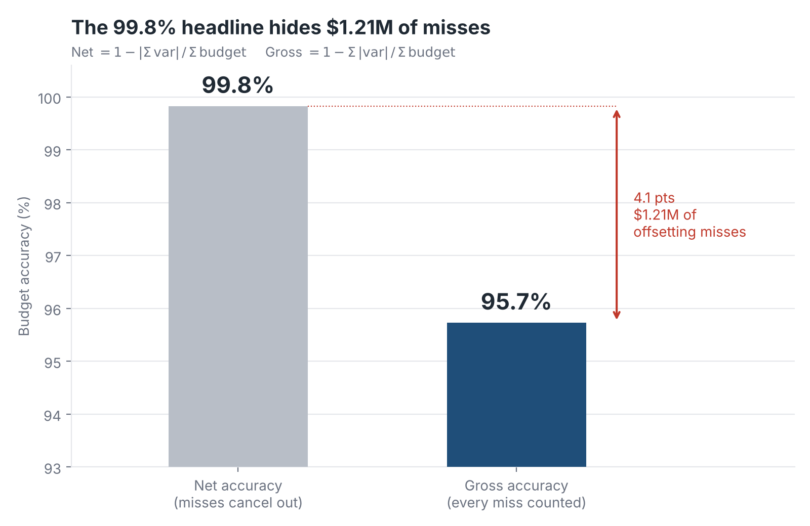
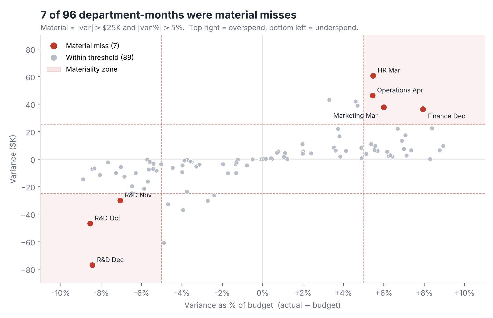
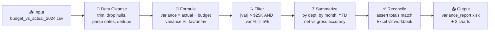

# FP&A Budget Variance Pipeline

**Karthik Bommisetty** · UIC MBA (Finance) + MS Business Analytics

**[Try the interactive version →](https://karthikvenkata-create.github.io/fpa.html)** · [My website](https://karthikvenkata-create.github.io) · [LinkedIn](https://www.linkedin.com/in/karthik-bommisetty)

I rebuilt my Excel budget-vs-actual project as a Python pipeline that runs end to end in one command and reconciles to my Excel workbook down to the dollar. The data covers $28.2M of 2024 operating spend across 8 departments and 12 months, 96 department-months in total.

> The data is a practice dataset, not a real company's books.

## Summary

- **The headline number hides the misses.** Net budget accuracy is **99.8%**, but that's only because overspends and underspends cancel each other out. When every miss is counted, accuracy drops to **95.7%**, which is **$1.21M** in misses.
- **Two errors offset each other.** Spend ran **$248K over** plan from January through August, then came in **$298K under** from September through December. The year ended $50K under budget, but the plan was off for most of the year.
- **7 of 96 department-months were material misses**, meaning both more than $25K *and* more than 5% off budget. Three of those were R&D in Q4.
- **R&D finished $114K under, mostly in Oct–Dec.** A late-year underspend like that usually means hiring or projects got pushed back, not real savings. That's the first question I'd take to the budget owner.





## The 7 material misses

| Department | Month | Variance | % of budget |
|---|---|---|---|
| R&D | Dec | −$76,990 | −8.4% |
| HR | Mar | +$60,759 | +5.5% |
| R&D | Oct | −$46,734 | −8.5% |
| Operations | Apr | +$46,284 | +5.4% |
| Marketing | Mar | +$37,782 | +6.0% |
| Finance | Dec | +$36,319 | +7.9% |
| R&D | Nov | −$29,963 | −7.1% |

Positive means overspend (unfavorable). These are cost centers, so coming in under budget counts as favorable.

There are also two near misses worth knowing about. HR in November was $60.7K under but only 4.9% off, so it misses the % test by a hair. Marketing in January was $43.2K over but only 3.3% off. Both thresholds are config values at the top of `pipeline.py`, so a stricter policy is a one-line change.

## Pipeline

The steps follow the same order you'd lay out on an Alteryx Designer canvas:



| Step | What it does |
|---|---|
| Input | Reads the raw CSV as text so nothing gets silently converted |
| Data Cleanse | Trims whitespace, strips `$` and commas, parses dates, drops nulls and duplicate dept-months |
| Formula | Variance, variance %, absolute variance, Favorable / Unfavorable |
| Filter | Flags material misses using both thresholds |
| Summarize | Totals, net and gross accuracy, by department, by month with YTD build |
| Reconcile | Checks every headline number against the Excel v2 workbook and fails loudly if anything is off |
| Output | Formatted Excel report (5 tabs) and two PNG charts |

**Accuracy definitions**

- Net accuracy = 1 − |Σ variance| / Σ budget, which lets misses cancel out
- Gross accuracy = 1 − Σ |variance| / Σ budget, which counts every miss

## Why a pipeline instead of Excel

My first version of this project was in Excel with Power Query, and it reported 99.8% accuracy and called Marketing the "top performer" for going over budget. Both of those were wrong. Rebuilding it as a pipeline is what made the errors obvious, and it also changes how the work scales:

- **Repeatable.** Next month's data runs through the same steps with no copy-paste and no broken `#REF!` links. My v1 dashboard actually had `#REF!` errors in its filter panel.
- **Auditable.** Every rule is in code, in order. A reviewer can read exactly how a number was produced instead of clicking through cells.
- **Self-checking.** The reconcile step means a bad input file or a logic change can't quietly shift the totals.
- **Configurable.** Materiality thresholds live in one place instead of being buried in formulas.
- **Scales.** The same code handles 96 rows or 96,000.

Excel is still the right tool for the final output a finance manager actually opens, so that's where the pipeline sends its results.

## Run it

```bash
pip install -r requirements.txt
python pipeline.py
```

Outputs land in `output/variance_report.xlsx` and `images/`.

## Repo layout

```
├── pipeline.py                    # the whole pipeline
├── data/budget_vs_actual_2024.csv # 96 dept-months, raw input
├── output/variance_report.xlsx    # Summary, Material Misses, By Department, By Month, Variance Data
├── images/accuracy_gap.png
├── images/variance_scatter.png
└── requirements.txt
```

## Project history

| Version | Date | Tool | What changed |
|---|---|---|---|
| v1 | Mar 2026 | Excel + Power Query | Original dashboard, reported 99.8% accuracy |
| v2 | Oct 2026 | Excel rebuild | Fixed sign logic, added gross accuracy, materiality, YTD timing |
| v3 | Oct 2026 | Python pipeline | This repo. Same numbers, automated and self-reconciling |

**Tools:** Python (pandas, matplotlib, openpyxl) · Excel · Power Query · Alteryx Designer Core certified
