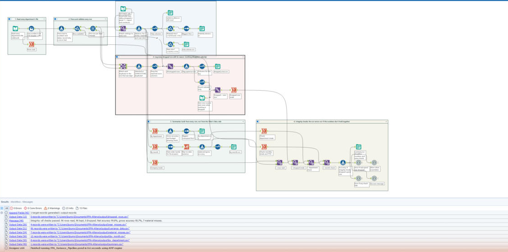

# FP&A Budget Variance Pipeline (Alteryx)

**Karthik Bommisetty** · UIC MBA (Finance) + MS Business Analytics · Alteryx Designer Core certified

**[Try the interactive version →](https://karthikvenkata-create.github.io/fpa.html)** · [Download the workflow](https://github.com/karthikVenkata-Create/FPA-Budget-Variance-Pipeline/archive/refs/heads/main.zip) · [My website](https://karthikvenkata-create.github.io) · [LinkedIn](https://www.linkedin.com/in/karthik-bommisetty)

An Alteryx Designer workflow that takes each department's budget-vs-actual file, accounts for every row it reads, and builds the variance report. The data covers $28.2M of 2024 operating spend across 8 departments and 12 months (96 department-months). On this data the workflow matches my original Excel workbook to the dollar.

> The data is a practice dataset, not a real company's books. The monthly budget phasing in particular is synthetic (see [About the data](#about-the-data)), so the timing patterns below show the method rather than a real finding.



## What it found

- **The headline number hides the misses.** Net budget accuracy is **99.8%**, but only because overspends and underspends cancel each other out. Total misses come to **$1.21M** ($578K over budget, $628K under), and **$1.16M** of that cancelled out, leaving a net of −$50K. Counting every miss, accuracy is **95.7%**.
- **7 of 96 department-months were material misses**, meaning more than $25K *and* more than 5% off budget. Another 4 were near misses: over $25K but between 4% and 5%.
- **The year looks on plan because of timing.** Spend ran $248K over plan through August, then $298K under from September to December. Three of the seven material misses are R&D in Q4.
- **The biggest finding is about the budget itself.** Every department's monthly budget swings at least 20x across the year, and Customer Success swings 512x. In a real company, phasing this lumpy would be the first thing I'd question, because it makes monthly variances almost meaningless.

### The 7 material misses

| Department | Month | Variance | % of budget |
|---|---|---|---|
| R&D | Dec | −$76,990 | −8.4% |
| HR | Mar | +$60,759 | +5.5% |
| R&D | Oct | −$46,734 | −8.5% |
| Operations | Apr | +$46,284 | +5.4% |
| Marketing | Mar | +$37,782 | +6.0% |
| Finance | Dec | +$36,319 | +7.9% |
| R&D | Nov | −$29,963 | −7.1% |

Positive means overspend (unfavorable). These are cost centers, so coming in under budget is favorable.

The near misses are HR Nov (−4.9%), R&D Apr (+4.7%), Customer Success Dec (−4.7%) and Marketing Jul (+4.6%). The rule needs both tests: the dollar test alone flags 15 months, the percent test alone flags 47 (mostly tiny months), and requiring both narrows it to the 7 that matter on both counts.

## Run it

1. Download the repo (the link above, or clone it) and open `FPA_Variance_Pipeline.yxmd` in Alteryx Designer. I built and tested it on 2025.2.
2. Press **Run**.
3. The Results window should show 0 errors, 0 warnings and *"Integrity: all checks passed. 96 rows read, 96 kept, 0 dropped. Net accuracy 99.8%, gross accuracy 95.7%, 7 material misses."*
4. The outputs land in `output/`.

To see the error handling, open `FPA_Variance_Pipeline_messy_test.yxmd`. It reads two messy submissions from `tests/messy_departments/` (dollar signs, extra spaces, three date formats, a negative budget, a conflicting duplicate, a blank budget next to real spend, unreadable values). The run finishes with 1 error: *"STOPPED: $1,033,999 of actual spend plus 1 row(s) whose actual couldn't be read is on rows that were dropped (5 rows, listed in dropped_rows.csv)..."*. Every output is still written, so `dropped_rows.csv` shows exactly which line in which file broke, and why.

## What the workflow does

| Section | Tools | What happens |
|---|---|---|
| 1. Read | Input Data (wildcard `data/departments/*.csv`), Multi-Row Formula | Stacks all 8 department files into one stream. Each row keeps its file name and line number so a bad row can be traced back to its source |
| 2. Parse and validate | Formula, Filter, Unique | Turns text into numbers and dates, strips `$` and commas, reads `(1,000)` as negative, and accepts `2024-01-01`, `3/1/2024` and `Feb 2024`. A row that can't be read gets a reason (`missing budget`, `unreadable month`...) and goes to the dropped-row log. Duplicate dept-months are split off |
| 3. Variance and materiality | Text Input (SETTINGS), Append Fields, Formula, Select, Filter, Sort | Variance, Fav / Unfav / On budget, and the material and near-miss flags. **All rows stay in the main stream**; the filters only add exception lists on the side |
| 4. Dropped-row log | Join, Formula, Union, Select, Text Input, Summarize | Matches each duplicate to the row that was kept and labels it *identical* or *CONFLICTS (kept: budget X, actual Y)*. Flags any dropped row that carried real spend |
| 5. Summaries | Summarize, Formula, Sort, Running Total | By department (with the budget-phasing check), by month (with the YTD build), and company totals, all from every row |
| 6. Integrity checks | Summarize, Append Fields, Formula, Message | Rows read = kept + dropped, department and monthly totals add up to the grand total, YTD ends at the net variance, plus four more and the dropped-spend rule. Anything that fails raises an **Error** in the Results window |

Thresholds live in the **SETTINGS** Text Input tool on the canvas. Set `allow_dropped_spend` to 1 to report dropped spend and continue. The error then becomes a warning marked OVERRIDDEN.

**Accuracy definitions:** net accuracy = 1 − |Σ variance| ÷ Σ budget (misses cancel out). Gross accuracy = 1 − Σ |variance| ÷ Σ budget (every miss counts). Cancelled out = Σ |variance| − |Σ variance|.

## Mistakes it avoids

These came from a first-draft plan for the workflow. Each one would have produced wrong numbers:

- **Summarizing the filter's False side.** Sending only the "not material" rows to Summarize drops the 7 material months from the executive totals, leaving net variance $27K off and gross misses $335K short.
- **Calculating gross accuracy per row.** A row-level `1 − |variance| / budget` can't be added or averaged into 95.7%. It has to be calculated after the Summarize.
- **Using Data Cleanse to strip `$` and commas.** Its "remove punctuation" option also strips minus signs and decimal points, so a −1,000 budget would quietly become 1000. A regex Formula handles it instead.
- **`ToNumber("")` returns 0 in Alteryx.** A blank budget cell would silently become a $0 budget. The workflow only converts text that actually looks like a number, so a blank is logged as `missing budget`.
- **Dividing by a zero or negative budget.** For those rows the % variance is left blank, the dollars stay in every total, and the department is flagged in `by_department.csv`.

## About the data

The monthly budgets don't look like a real company's. Sales is budgeted $18.6K in April, $6.5K in August and $1.09M in September. Marketing goes from $1.31M in January to $4.3K in June. The workflow flags this automatically in `by_department.csv`: any department whose biggest monthly budget is more than 10x its smallest gets marked "Question this phasing", and all 8 here do (from 21x for IT up to 512x for Customer Success).

The annual and department-level numbers still hold up. The month-level story doesn't. With phasing this lumpy, a monthly variance mostly tells you the budget was put in the wrong month, so on a real budget I'd want the phasing fixed before reading anything into individual months.

## Outputs

| File | What's in it |
|---|---|
| `summary.csv` | Headline numbers and the result of every integrity check |
| `variance_data.csv` | Every kept row with variance, %, Fav / Unfav and flags, plus its source file and line |
| `material_misses.csv` / `near_misses.csv` | The 7 and the 4 |
| `by_department.csv` | Totals, gross accuracy and budget-phasing ratio per department |
| `by_month.csv` | Monthly totals and the YTD variance build |
| `dropped_rows.csv` | Every dropped row, its file and line, the reason, and whether it carried spend (empty on the clean data) |

`output_messy_test/` holds the outputs from the messy-data run.

## Repo layout

```
├── FPA_Variance_Pipeline.yxmd             # the workflow
├── FPA_Variance_Pipeline_messy_test.yxmd  # same logic, reads tests/messy_departments/
├── build_workflow.py                      # generates both .yxmd files from one definition
├── data/departments/                      # one CSV per department
├── tests/messy_departments/               # deliberately messy submissions
├── output/, output_messy_test/            # outputs from my Designer runs
└── images/alteryx_canvas.png
```

Both workflows are generated by `build_workflow.py`, so the clean and messy versions can't drift apart and every expression can be reviewed as plain text.

## Known limits

- Every file has to use the same four column headers (`department, month, budget, actual`). The wildcard input doesn't rename mismatched headers.
- When a check fails, the run ends with an error, but the outputs are still written. That's on purpose, so you can see why it failed. Check that the Results window shows 0 errors before trusting the numbers. `summary.csv` also records `all_checks_pass` and `dropped_spend_status`.

## What's next

A full-year reforecast: given actuals through September, where does the year land? That's most of what FP&A teams actually do. The workflow groups months by their actual date rather than calendar position, so it is set up for partial-year and fiscal-year files, and a reforecast would build on top of it.

## Project history

| Version | Date | Tool | What changed |
|---|---|---|---|
| v1 | Mar 2026 | Excel + Power Query | Original dashboard, reported 99.8% accuracy |
| v2 | Oct 2026 | Excel rebuild | Fixed sign logic, added gross accuracy, materiality, YTD timing |
| v3 | Oct 2026 | Alteryx Designer | This repo: automated, accounts for every row, checks itself |
