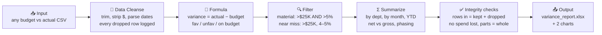

# FP&A Budget Variance Pipeline

**Karthik Bommisetty** · UIC MBA (Finance) + MS Business Analytics

**[Try the interactive version →](https://karthikvenkata-create.github.io/fpa.html)** · [My website](https://karthikvenkata-create.github.io) · [LinkedIn](https://www.linkedin.com/in/karthik-bommisetty)

I rebuilt my Excel budget-vs-actual project as an automated pipeline, in two versions that give identical numbers:

- **[Alteryx Designer workflow](alteryx/)**: the main version. It reads each department's own file with a wildcard input, logs every dropped row with its reason, and raises an error in the Results window if the numbers don't hold together.
- **Python pipeline** (this folder): the tested reference. 32 pytest tests, including 4 that check the Alteryx outputs against it.

Both turn any department-by-month budget vs actual data into a variance report, account for every row they read, and match my original Excel workbook to the dollar. The data covers $28.2M of 2024 operating spend across 8 departments and 12 months, 96 department-months in total.


> The data is a practice dataset, not a real company's books. The monthly budget phasing in particular is synthetic (see [About the data](#about-the-data)), so the timing patterns below show the method rather than a real finding.

## Summary

- **The headline number hides the misses.** Net budget accuracy is **99.8%**, but only because overspends and underspends cancel each other out. Total misses come to **$1.21M** ($578K over budget, $628K under), and **$1.16M** of that cancelled out, leaving a net of −$50K. Counting every miss, accuracy is **95.7%**.
- **7 of 96 department-months were material misses**, meaning both more than $25K *and* more than 5% off budget. Another 4 were near misses: over $25K but between 4% and 5%.
- **The year looks on plan because of timing.** Spend ran $248K over plan through August, then $298K under from September to December. Three of the seven material misses are R&D in Q4.
- **The biggest finding is about the budget itself.** Every department's monthly budget swings at least 20x across the year, and Customer Success swings 512x. In a real company, phasing this lumpy would be the first thing I'd question, because it makes monthly variances almost meaningless.


## The 7 material misses

| Department | Month | Variance | % of budget |
|---|---|---|---|
| R&D | Dec | −$76,990 | −8.4% |
| HR | Mar | +$60,759 | +5.5% |
| R&D | Oct | −$46,734 | −8.5% |
| Operations | Apr | +$46,284 | +5.4% |
| Marketing | Mar | +$37,782 | +6.0% |
| Finance | Dec | +$36,319 | +7.9% |
| R&D | Nov | −$29,963 | −7.1% |

Positive means overspend (unfavorable). These are cost centers, so coming in under budget is favorable, and a variance of exactly $0 is labeled "On budget."

**Near misses.** I define a near miss as passing the dollar test (over $25K) but landing between 4% and 5%. That gives exactly four: HR Nov (−$60,692, −4.9%), R&D Apr (+$39,045, +4.7%), Customer Success Dec (−$32,685, −4.7%) and Marketing Jul (+$41,995, +4.6%). All the thresholds are config values at the top of `pipeline.py`, so a stricter policy is a one-line change.

The rule needs both tests. With the dollar test alone, 15 months get flagged. With the percent test alone, 47 do, mostly small months where a few thousand dollars is a big percentage. Requiring both gets it down to the 7 that matter on both counts.

## About the data

The monthly budgets don't look like a real company's. Sales is budgeted $18.6K in April, $6.5K in August and $1.09M in September. Marketing goes from $1.31M in January to $4.3K in June. Real department budgets don't swing like that month to month.

The pipeline flags this automatically on a "Budget Phasing" tab. Any department whose biggest monthly budget is more than 10x its smallest gets flagged, and all 8 departments here do:

| Department | Smallest month | Biggest month | Swing |
|---|---|---|---|
| Customer Success | $1,363 | $697,211 | 512x |
| Marketing | $4,280 | $1,310,207 | 306x |
| Sales | $6,473 | $1,090,283 | 168x |
| Operations | $15,447 | $936,211 | 61x |
| Finance | $22,781 | $1,107,759 | 49x |
| R&D | $27,468 | $912,818 | 33x |
| HR | $37,393 | $1,239,326 | 33x |
| IT | $28,305 | $592,649 | 21x |

Here's what that means for the analysis. The annual and department-level numbers (net vs gross accuracy, which departments over- or underspent) still hold up. The month-level story doesn't. Patterns like "R&D underspent in Q4" are what the method would surface, but with phasing this lumpy, a monthly variance mostly tells you the budget was put in the wrong month. On a real budget, I'd want the phasing fixed before reading anything into individual months.

## Pipeline

Both versions run the same steps. The [Alteryx README](alteryx/) maps each one to its tools, and lists five mistakes in a first-draft Alteryx plan that would have produced wrong numbers. The Python version:



| Step | What it does |
|---|---|
| Input | Reads the raw CSV as text so nothing gets silently converted |
| Data Cleanse | Trims whitespace, strips `$` and commas, reads `(1,234)` as negative, handles mixed date formats. Rows with missing or unreadable values and duplicate dept-months are dropped, but every one goes on a Dropped Rows tab with its line number and reason. Duplicates that conflict with the kept row are called out separately from identical ones |
| Formula | Variance, variance %, absolute variance, Favorable / Unfavorable / On budget. A budget of zero or less keeps its dollars in every total but gets no % variance (no divide-by-zero, no backwards signs) and is listed on the Data Quality tab |
| Filter | Flags material misses and near misses |
| Summarize | Totals, net and gross accuracy, by department, by month in date order with a YTD build, where the running variance peaked, budget phasing check |
| Integrity checks | 13 checks that hold for **any** input file (below). The run stops if one fails |
| Output | Excel report (10 tabs) and two PNG charts |

**Integrity checks (every run, any data):** rows read = rows kept + rows dropped; every dropped row has a reason; one row per department-month; budget in = budget out; actual in = actual out; department totals add to the grand total; monthly totals add to the annual total; year-to-date variance ends at the net variance; variance = actual − budget on every row; gross misses ≥ |net variance|; material and near-miss flags never overlap; variance % only where budget > 0; no actual spend lost on dropped rows.

**Dropped spend stops the run.** If a row that carried actual spend gets dropped (say, a blank budget cell next to $12K of real spend), the pipeline stops and names the line, because silently dropping it would understate what was spent. Spend on an identical duplicate doesn't count, since the kept row already has it. An actual that can't be read counts as at risk, because the amount is unknown. To continue anyway, run with `--allow-dropped-spend`. The check then shows as OVERRIDDEN, not passed, with the dollar amount.

**One-time validation (2024 file only):** `tests/test_baseline_2024.py` checks that this pipeline reproduces my Excel v2 workbook to the dollar. Those expected numbers are hardcoded on purpose, because they only apply to this one file. A new file gets the integrity checks, not this test.

**Accuracy definitions**

- Net accuracy = 1 − |Σ variance| / Σ budget, which lets misses cancel out
- Gross accuracy = 1 − Σ |variance| / Σ budget, which counts every miss
- Cancelled out = Σ |variance| − |Σ variance|

## Why a pipeline instead of Excel

My first version of this project was in Excel with Power Query. It reported 99.8% accuracy and called Marketing the "top performer" for going over budget, and both of those were wrong. Rebuilding it as a pipeline is what made the errors obvious, and it also changes how the work holds up:

- **Repeatable.** Next month's file runs through the same steps: `python pipeline.py path/to/new_file.csv`. There's no copy-paste and there are no broken `#REF!` links. My v1 dashboard actually had `#REF!` errors in its filter panel.
- **Self-checking.** The integrity checks run on every file, so a bad input or a logic change can't quietly shift the totals. The tests include a deliberately broken summary to prove the checks catch it.
- **Accounts for every row.** Nothing disappears silently. Every dropped row is listed with its reason, and dropping real spend stops the run instead of quietly understating it.
- **Tested on messy input.** `tests/fixtures/messy_sample.csv` has `$` signs, extra spaces, three date formats, a negative budget, a conflicting duplicate, a blank budget next to real spend, and unreadable values. The tests check exactly which rows survive, why each dropped row was dropped, and that the run stops on the lost spend.
- **Auditable.** Every rule is in code, in order. A reviewer can see exactly how a number was produced instead of clicking through cells.
- **Configurable.** Materiality, near-miss and phasing thresholds live in one place instead of being buried in formulas.

Excel is still the right tool for the final output a finance manager actually opens, so that's where the pipeline sends its results.

## Run it

**Alteryx:** open `alteryx/FPA_Variance_Pipeline.yxmd` in Designer and press Run (details in [alteryx/README.md](alteryx/)).

**Python:**

```bash
pip install -r requirements.txt
python pipeline.py                                    # the 2024 data
python pipeline.py tests/fixtures/messy_sample.csv    # stops: rows with real spend were dropped
python pipeline.py tests/fixtures/messy_sample.csv --allow-dropped-spend   # report it and continue
python -m pytest                                      # 32 tests, incl. Alteryx-vs-Python cross-check
```

Outputs land in `output/variance_report.xlsx` and `images/`.

## Repo layout

```
├── alteryx/
│   ├── FPA_Variance_Pipeline.yxmd         # the Alteryx workflow (reads data/departments/*.csv)
│   ├── FPA_Variance_Pipeline_messy_test.yxmd
│   ├── build_workflow.py                  # generates both .yxmd files from one definition
│   ├── data/departments/                  # one CSV per department
│   ├── output/, output_messy_test/        # outputs from my Designer runs
│   └── README.md
├── pipeline.py                        # the Python pipeline
├── data/budget_vs_actual_2024.csv     # 96 dept-months, raw input
├── output/variance_report.xlsx        # Summary, Material Misses, Near Misses, By Department, By Month,
│                                      # Budget Phasing, Data Quality, Dropped Rows, Integrity Checks,
│                                      # Variance Data
├── images/accuracy_gap.png
├── images/variance_scatter.png
├── tests/
│   ├── test_cleanse.py                # messy input: dropped-row reasons, duplicates, parsing
│   ├── test_integrity.py              # new and fiscal-year data, lost rows, dropped spend, bad budgets
│   ├── test_baseline_2024.py          # one-time match to the Excel v2 workbook
│   ├── test_alteryx_matches_python.py # Alteryx outputs = Python results
│   └── fixtures/messy_sample.csv
└── requirements.txt
```

## What's next

The natural next step is a full-year reforecast: given actuals through September, where does the year land? That's most of what FP&A teams actually do, more than looking backward at variance. The pipeline already handles partial-year and fiscal-year files (there are tests for both), so a reforecast would build on top of it.

## Project history

| Version | Date | Tool | What changed |
|---|---|---|---|
| v1 | Mar 2026 | Excel + Power Query | Original dashboard, reported 99.8% accuracy |
| v2 | Oct 2026 | Excel rebuild | Fixed sign logic, added gross accuracy, materiality, YTD timing |
| v3 | Oct 2026 | Python pipeline | Same numbers, plus integrity checks, row accounting, data-quality flags, near misses and tests |
| v4 | Oct 2026 | Alteryx Designer | The same pipeline as a Designer workflow reading each department's file, cross-checked against v3 |

**Tools:** Alteryx Designer (Core certified) · Python (pandas, matplotlib, openpyxl, pytest) · Excel · Power Query
